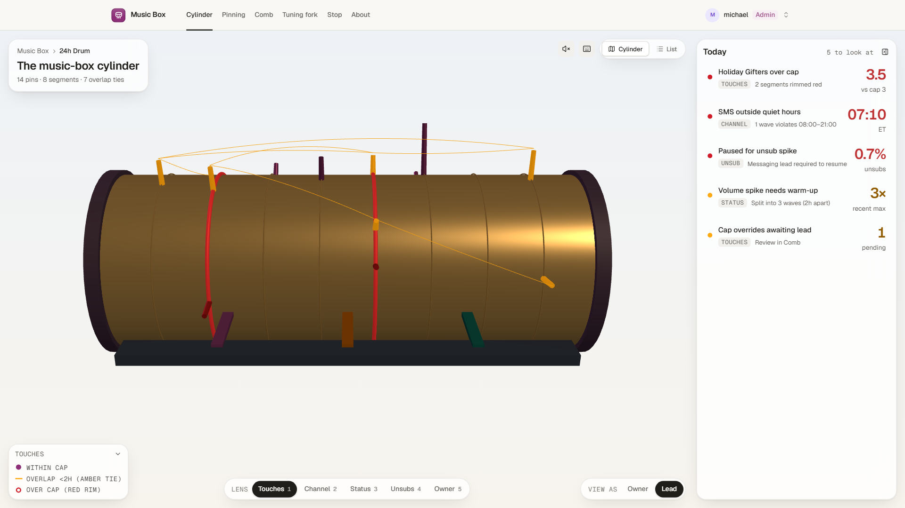

# Music Box

One shared campaign send calendar that does the overlap arithmetic: expected touches per subscriber per day, channel fatigue caps, recipient-local SMS quiet hours, warm-up wave splitting, and automatic pause on unsubscribe spikes.



## The problem & rules

During peak holiday weeks, five marketing teams schedule over a dozen email, SMS, and push campaigns on the same day. Subscribers in overlapping segments receive seven messages before noon, SMS waves land at 06:10 in Chicago, sudden 3× volume spikes hurt deliverability, and unsubscribe spikes go unnoticed overnight.

Music Box enforces five pure rules (`src/domain/config.ts`, `src/domain/rules.ts`):

1. **Expected touches** — `E(S, channel) = Σ shared(S, seg(c)) / size(S)` (with `shared(S, S) = size(S)`). Exceeding `CAPS` (`email: 3`, `sms: 1`, `push: 2`) blocks scheduling unless the Messaging lead approves an override with a 20+ character reason.
2. **Quiet hours** — SMS sends are allowed only between `08:00` and `21:00` recipient-local time. Local-time sends split into per-UTC-offset waves and block if any wave violates quiet hours.
3. **Throughput** — Send duration is `ceil(audience / throttlePerHour)` hours; overlapping sending windows on the same channel raise a warning.
4. **Warm-up** — Audiences above `2×` the largest single-day volume of the last 7 days on that channel are split automatically into three progressive waves (`[0.25, 0.5, 1]`) two hours apart.
5. **Auto-pause** — After `2,000` delivered, an unsubscribe rate at or above `0.5%` (email) or `1.0%` (SMS/push) pauses the campaign automatically; only the Messaging lead can resume it.

## What it looks like

The home centrepiece (**The music-box cylinder**) is a lazy-loaded Three.js brushed-brass cylinder with steel pins and a three-tine channel comb at the front (plus a complete unrolled piano-roll SVG fallback for `?nowebgl` and reduced motion). The circumference is 24 hours, the drum length holds 8 audience segments, and pin height encodes audience size. Overlapping pins within two hours glow amber with linking ties, and over-cap segment rows are rimmed red. Sound is off by default with an optional soft chime toggle.

- **Lenses (1–5):** Touches, Channel, Status, Unsubs, Owner.
- **View as (V):** Campaign owner or Messaging lead.
- **Tools:** Cylinder, Pinning, Comb, Tuning fork, Stop, About.
- **Fallbacks:** Complete unrolled piano-roll SVG (`?nowebgl` / reduced motion) and accessible List view (`L`) with `E(S)` and collision pair badges per row.

## Prerequisites

- Microsoft Fabric Apps workload enabled in a workspace on a Fabric capacity
- Workspace **Edit** permission to deploy and apply the Rayfin data schema
- Node.js 20+ (tested on Node 24)

## Run locally

```bash
# At the repository root
npm install

# Demo mode (in-memory store, deterministic seed, persona switcher) on port 5240
npm run dev -w @x10/music-box

# Connected to Microsoft Fabric
npm run dev:fabric -w @x10/music-box
```

## Deploy

```bash
cd apps/music-box
npx rayfin up --workspace-id <workspace-id>
```

## Seed & admin setup

```bash
npm run seed:fabric -w @x10/music-box -- --admin-email you@org.com
```

## How it works

| Entity | Key fields | Row-level security | Domain enforcement |
| --- | --- | --- | --- |
| `Segment` | `name`, `size`, `ownerSub` | `authenticated` read; writes `claims.sub.eq(item.ownerSub)` | Positive size and unique segment overlap bounds |
| `SegmentOverlap` | `segmentA`, `segmentB`, `sharedCount`, `ownerSub` | `authenticated` read; writes `claims.sub.eq(item.ownerSub)` | `sharedCount <= min(sizeA, sizeB)` |
| `Campaign` | `name`, `channel`, `segmentId`, `sendAt`, `audience`, `throttlePerHour`, `localTime`, `status`, `delivered`, `unsubs`, `capOverrideReason?`, `approvedBySub?`, `waveGroup?`, `waveIndex?`, `ownerSub` | `authenticated` read; create/update/delete `claims.sub.eq(item.ownerSub)` | Rules 1–5 (caps, quiet hours, throughput, 3-wave warm-up, auto-pause); lead-only override approval and resume |

## Known limits

- Rayfin DAB row policies scope `Campaign` updates to `ownerSub`; Messaging lead approvals and resume actions on another owner's campaign are enforced in `src/domain/campaigns.ts` and would use a dedicated lead-action child entity in multi-tenant production.
- Recipient timezone waves use four North American offsets (`UTC-5` through `UTC-8`) rather than subscriber-level IANA geolocation lookups.

## Later

- Direct ESP/SMS webhook ingestion for live `delivered` and `unsubs` telemetry.
- Custom per-region quiet-hour calendars for international audiences.
- Exportable daily send-schedule digest for marketing operations.

## Gallery

**Title:** 12 Days of Fabric Apps: Day 1.8 – Music Box

**Blurb:** Built by Datachain Consulting for AI at Work, Music Box turns chaotic peak-season campaign scheduling into a brushed-brass music-box cylinder. Every audience segment is a track, the circumference is twenty-four hours, and every email, SMS, or push send is a steel pin sized by audience. Overlapping pins within two hours glow amber with linking ties, over-cap segments rim red, SMS quiet-hour violations block early waves, 3× spikes split into three warm-up waves, and unsubscribe spikes pause automatically until the Messaging lead resumes.

**Tags:** `Partner | 12 Days of Fabric Apps`
